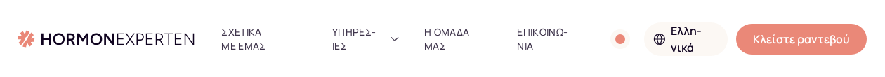
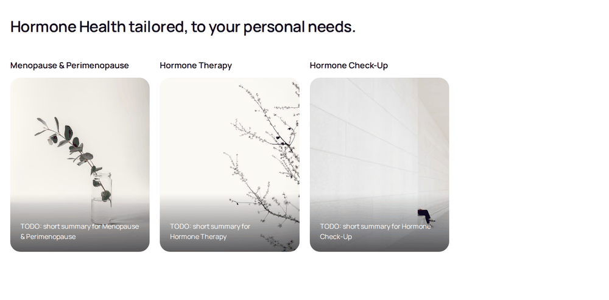
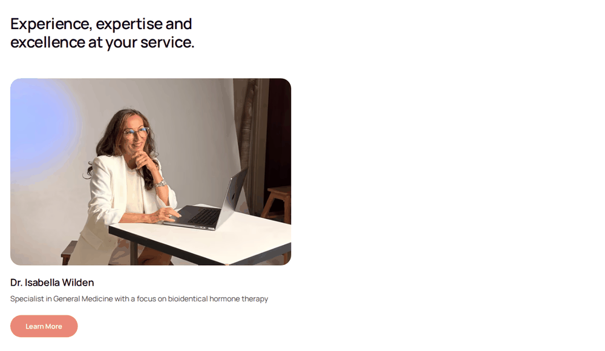
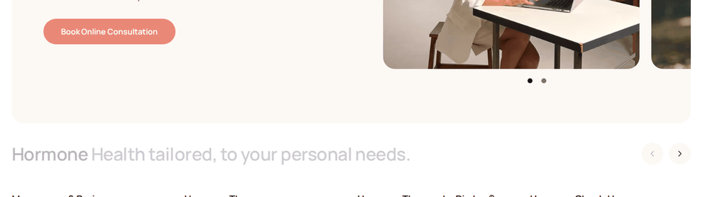
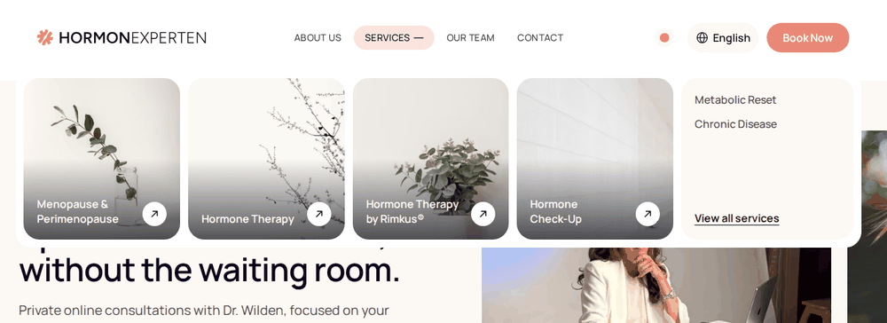
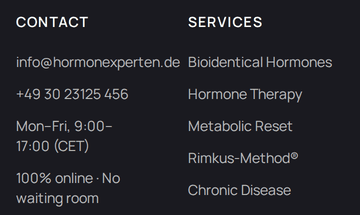
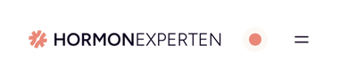
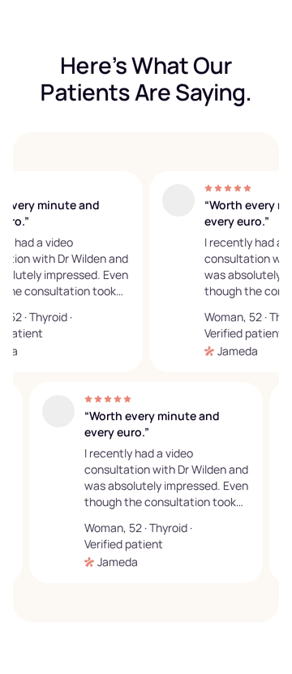

# Fixes to review

The fix list from the design audit of 11 Oct 2026. The reasoning, test method and Chromium vs Safari notes are in [`design-audit.md`](design-audit.md); launch blockers (booking URL, legal pages, redirects) are in [`launch-audit.md`](launch-audit.md).

How to review: tick the box to approve an item, or add a note under it (`> skip`, `> change: …`). Items are grouped by who can unblock them. Each has an ID so it can be referred to in conversation ("do F3 and F7").

---

## 1. Code fixes: no decision needed

- [ ] **F1. Greek header breaks at 1440px.** Nav labels wrap and split mid-word ("ΥΠΗΡΕΣ-ΙΕΣ", "Ελλη-νικά"). Cause: `text-wrap: pretty` / `balance` are shorthands and reset `text-wrap-mode`, which cancels `whitespace-nowrap` on any parent of `li`, `p` or headings.
  - Fix: use `text-wrap-style: pretty` / `text-wrap-style: balance` instead.
  - Where: `src/styles/global.css:410`, `:416`
  - After the fix the Greek bar may be too wide at 1440px; see F14.
  - 

- [ ] **F2. The palette tester ships to visitors.** It shows a dot in the header at every width and writes to localStorage (privacy page says nothing is stored).
  - Fix: show it only in `astro dev` (or remove it once the palette is final).
  - Where: `src/components/sections/Header.astro:190`, `src/scripts/header.ts`

- [ ] **F3. Services row leaves an empty quarter in production.** With unconfirmed services hidden, 3 cards sit in a row sized for 4.
  - Fix: size cards by count (3 or fewer fill the row); the rail only scrolls when the row overflows.
  - Where: `src/components/sections/Services.astro:32`
  - 

- [ ] **F4. Team shows one card next to an empty half in production.**
  - Fix: a single-member layout (photo and text side by side, like the profile hero) when only one doctor is visible.
  - Where: `src/components/sections/Team.astro:25`, `src/components/sections/TeamMembers.astro:35`
  - 

- [ ] **F5. A heading loads looking disabled.** At 1440×900 the Services heading sits low on the first screen, so the word reveal starts it at 20% opacity (about 1.6:1 contrast).
  - Fix: start the reveal lower so nothing above the fold loads faded.
  - Where: `reveal-word` in `src/styles/global.css`
  - 

- [ ] **F6. Reading text fades in word by word.** The Our Approach paragraph sits at 20% opacity until it scrolls up.
  - Fix: keep the reveal on headings only.
  - Where: `src/components/sections/Approach.astro:37`

- [ ] **F7. Services row slides by itself** 1.5s after it comes into view, moving content under the reader.
  - Fix: remove the intro slide; the peek of the next card already shows there's more.
  - Where: `src/scripts/service-rail.ts:11` and the intro block below it

- [ ] **F8. Hero trust line cycles every 2s on phones, forever, with no pause** (fails WCAG 2.2.2 once the claims go live).
  - Fix: show it static, wrapped onto two lines.
  - Where: `src/components/sections/Hero.astro`, `src/scripts/hero-trust-cycler.ts`

- [ ] **F9. Trust logos turn every 2s, forever.** Hover pauses them; touch and keyboard can't (WCAG 2.2.2).
  - Fix: a static row, or stop after one full turn.
  - Where: `src/scripts/logo-cycler.ts:8`

- [ ] **F10. Mega menu has no edge.** The white panel melts into the cream hero and sits right on the H1. The language and palette popovers use `ring-1 ring-ink/10`.
  - Fix: same ring on the mega menu panel.
  - Where: `src/components/sections/Header.astro:128`
  - 

- [ ] **F11. Footer at 360px:**
  - The email runs into the column gap on every page.
  - Links are only 20px tall.
  - "9:00–17:00" breaks after the dash.
  - The blurb is `text-sm` where the type rules say `text-body`.
  - Fix: padding on the links themselves (36px+ targets), let the email break, extend `typeset()` to keep number ranges together, set the blurb in `text-body`.
  - Where: `src/components/sections/Footer.astro:40`, `:69`, `src/lib/content.ts`
  - 

- [ ] **F12. Hero carousel dots are 24px targets.** That meets the minimum but is small for a 40+ audience.
  - Fix: keep the 10px dot, make the button 44px.
  - Where: `src/components/sections/Hero.astro:131`

- [ ] **F13. Deck step tracker lags.** It only switches when a card has 95% landed, by which time the card has covered the previous step's text.
  - Fix: switch at about 50%.
  - Where: `src/scripts/step-stack.ts:12`

---

## 2. Needs your decision

- [ ] **F14. Full nav from 1280px instead of 1440px.** Laptops at 1280–1439px get the hamburger today. Measured at 1280px, the bar has about 1,075px for its contents; English needs 1,023, Russian 1,065, German 1,108.
  - Proposal: remove the palette dot (F2), show the language switcher as globe + code (as CLAUDE.md specifies), then set `--breakpoint-header-desktop` to 80rem. Greek may also need `px-3` nav padding.
  - Where: `src/styles/global.css:90`, `src/components/ui/LanguageSwitcher.astro`

- [ ] **F15. Nav labels at 16px sentence case.** They are 14px uppercase today; the type rules say nav uses the UI role (16px) and uppercase is for eyebrows only. About the same width, easier to read.
  - Where: `src/components/sections/Header.astro:49`

- [ ] **F16. Book button in the phone header.** Below 640px the header has no Book button; after the hero, the next booking button is at the bottom of the page.
  - Proposal: a compact "Book" pill in the slot the palette dot frees up.
  - Where: `src/components/sections/Header.astro:267`
  - 

- [ ] **F17. Coral for booking only.** The home page has 5 coral buttons for 3 actions (book, Learn More ×2, Get in touch).
  - Proposal: Learn More and Get in touch become the secondary variant; the team card link becomes a text link or secondary button.
  - Where: `Approach.astro`, `Team.astro`, `TeamMembers.astro`, `FaqContact.astro`

- [ ] **F18. One label for booking.** Today: "Book Now", "Book Online Consultation", "Start with a consultation", "Book your consultation".
  - Proposal: "Book a consultation" everywhere, "Book" in the header.
  - Where: content files (`home`, `services`, `team`, `site`) in all four locales

- [ ] **F19. Testimonials drift forever** (WCAG 2.2.2 once they go live).
  - Proposal: no drift, manual swipe. On phones, one row of whole cards, full text (or a "Read on Jameda" link), no grey avatar placeholders.
  - Where: `src/components/sections/Testimonials.astro:69`, `:86`, `src/scripts/grab-scroll.ts`
  - 

- [ ] **F20. Shorter hero image on phones.** Image-first pushes the H1 and CTA to the bottom of the first screen, and below it on short phones. The H1 is also 22px there, smaller than the section H2s (launch audit #11).
  - Proposal: 4:3 crop below `md`; H1 in `text-display`.
  - Where: `src/components/sections/Hero.astro:81`, `:116`

---

## 3. Needs the practice

- [ ] **F21. Replace the contact photo.** It shows Google Gemini, an AI chatbot, in French, greeting a stranger by name. On a doctor's "Get in touch" card it suggests AI answers patient questions.
  - Fix: a real photo of the practice or Dr. Wilden, or no image.
  - Where: `src/assets/images/contact.jpg`, used in `home/en.json:211`, `faq/en.json:10`, `about/en.json:13`
  - 

- [ ] **F22. Photo shoot.** Dr. Wilden's photo appears 3 times on the home page; the second hero slide is a 683px stock portrait cropped to landscape; service images are 536px wide and generic. Shot list:
  1. Dr. Wilden portrait, landscape, plain warm background
  2. Dr. Wilden on a video call, seen from the side
  3. Hands and laptop with a booking or patient-portal screen (practice branding only)
  4. Blood-test context: kit or results printout
  5. Two or three lifestyle images of women 45–60, consistent light and colour
  6. All originals at least 2,000px on the long edge

- [ ] **F23. Prices.** No price appears anywhere, and the cost and booking FAQ answers are `TODO`. The live site has `/kosten` (programmes 380 € / 499 €, first consultation 180 €).
  - Fix: a Costs page or section, linked from the booking CTAs and the FAQ, plus one line near the main CTA on what happens after clicking Book.

- [ ] **F24. Stray comma** in the English Services heading: "Hormone Health tailored, to your personal needs."
  - Where: `src/content/home/en.json`

---

## 4. Check on real devices

Headless WebKit on Linux can't show these; they need a real iPhone or Mac.

- [ ] **F25. German hyphenation in Safari.** German FAQ page at 360px on an iPhone (current iOS, and iOS 17/18 if available): no short words split in headings.
- [ ] **F26. Book Now roll in Safari on a Mac:** timing and smoothness on hover.
- [ ] **F27. Mobile menu sheet and stacking deck on an iPhone:** open/close animation and the deck while scrolling.
- [ ] **F28. Oldest supported iOS.** The site needs Safari 16.4+ (Tailwind v4); older iPhones get a broken page. Check the share of iOS < 16.4 in the live site's analytics and decide whether that's acceptable.

---

## Review notes

<!-- Add general notes here during the review. -->
